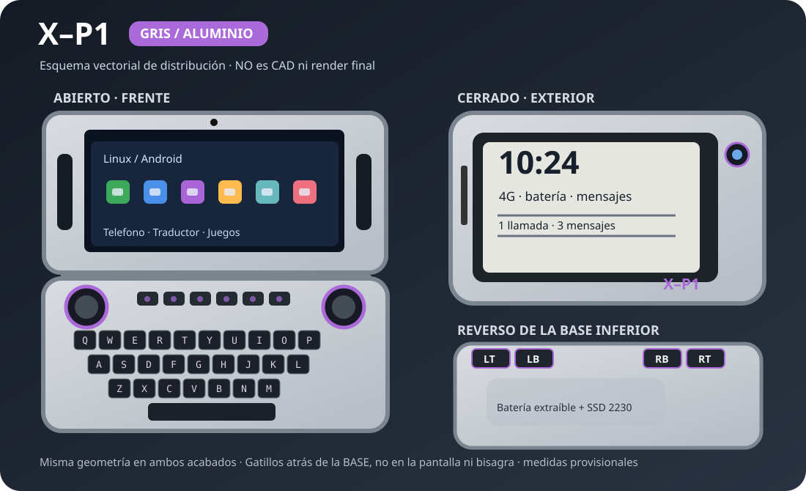
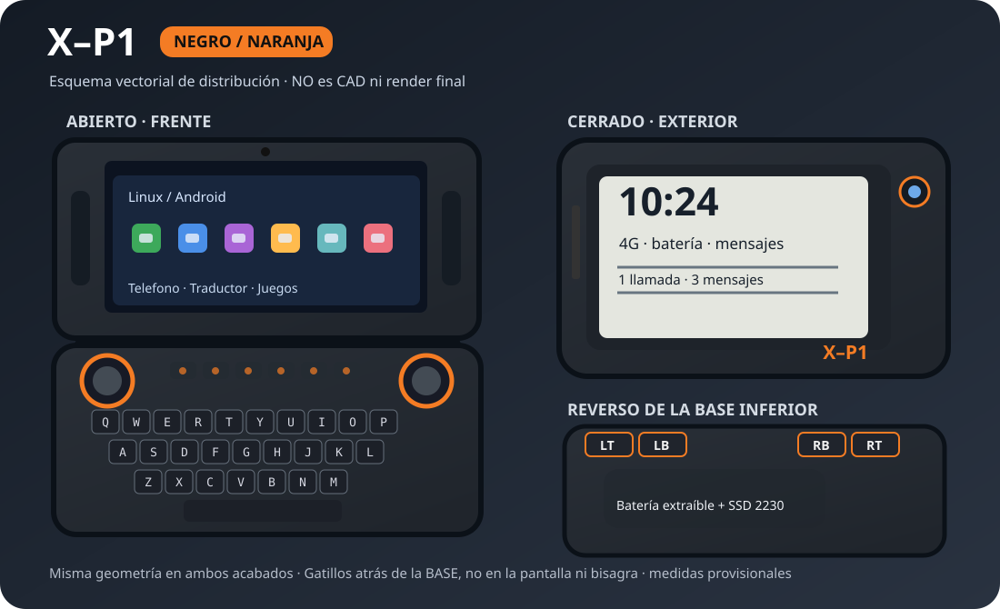

# X-P1 Open Phone — ¿construimos un teléfono plegable, modular y asequible?

[English version](README.en.md) · [Convocatoria para colaborar](COMMUNITY_CALL_ES.md) · [Especificaciones](docs/ESPECIFICACIONES.md) · [Lista preliminar de materiales](docs/BOM.csv) · [Riesgos y preguntas abiertas](docs/RETOS_TECNICOS.md)

> **Estado: propuesta abierta / búsqueda de colaboradores.** No existe todavía un prototipo funcional ni esquemas, Gerbers, STL/STEP o firmware validados. Las imágenes son **renders conceptuales generados por IA**, no dibujos de fabricación. Las características y cotas son objetivos sujetos a investigación y cambios. No se han confirmado precios ni compatibilidad telefónica con operadores.

### Vista conceptual comparativa (esquemas vectoriales provisionales)

| Gris aluminio/plástico | Negro con detalles naranjas |
|---|---|
|  |  |

Los dos SVG son diagramas simplificados creados para documentar la distribución; **los renders PNG originales se encuentran aún en el paquete externo pendiente de importar**. No son planos de fabricación.

## La idea

**X-P1** es una propuesta para desarrollar en comunidad un pequeño dispositivo plegable inspirado en los traductores electrónicos y las agendas Casio de los años 90. Queremos que sea a la vez **un teléfono 4G real, un traductor, una consola retro y una computadora Linux/Android de bolsillo**.

La idea central no es vender un dispositivo imposible de reparar o dependiente de un fabricante: es publicar documentación suficientemente clara para que **cualquier aficionado con experiencia básica en electrónica y ensamblaje pueda pedir componentes por internet y construir uno**. Las piezas comerciales deberían proceder, en lo posible, de catálogos de amplia distribución (AliExpress y otros proveedores). Las partes a medida —PCB, carcasa, tapas, botones, soportes— deberían poder pedirse a empresas como **PCBWay** o fabricarse localmente, por ejemplo mediante impresión 3D.

**Prioridad:** bajo costo total *real*, piezas disponibles, reparabilidad, documentación reproducible y modularidad. Si una función encarece o complica demasiado el primer prototipo, podremos posponerla o ofrecerla como opción. No hay compromiso de financiación ni lanzamiento comercial.

## Diseño industrial: DOS acabados, un mismo equipo

| Acabado gris | Acabado negro con naranja |
|---|---|
| Diseño gris aluminio/plástico | Diseño negro con líneas y logotipo naranja |

1. **Gris:** aluminio y plástico, pequeños acentos violetas.
2. **Negro:** mismo chasis, con **líneas naranjas finas y logotipo X-P1 naranja**.

La **geometría, puertos, ubicaciones de componentes, accesos de servicio y botones tienen que ser idénticos** en ambas versiones: cambian únicamente materiales/acabados de las piezas visibles.

**Importante:** los cuatro botones de juego **LT/LB y RB/RT van en la parte trasera de la BASE INFERIOR**, donde se sujetan los dedos al jugar abierto, inspirados en la disposición trasera del New Nintendo 2DS XL. **No** deben ir en la tapa-pantalla ni sobresalir del lomo/bisagra; el diseño debe permitir cerrar completamente el dispositivo. Funcionarían como controles de juego solo cuando está abierto.

## Qué queremos que consiga

- **Teléfono 4G LTE real**: llamadas entrantes y salientes, SMS y datos con nano-SIM. Queremos **contestar y hablar con el equipo cerrado**, desde la pantalla E-Paper táctil exterior, con auricular y micrófono externos. La compatibilidad VoLTE con cada operador debe probarse.
- **Dos modos de uso**: cerrado como teléfono/notificador/traductor; abierto como computadora de bolsillo y consola retro.
- **Linux** como plataforma de desarrollo, y **Android** como segunda opción; el arranque dual es objetivo de exploración, no función garantizada.
- **Pantalla interior** táctil IPS de unas 4 pulgadas; **pantalla exterior** de tinta electrónica táctil de unas 4.7 pulgadas, para hora, llamadas, notificaciones, lectura y acciones rápidas.
- **Teclado físico QWERTY**, dos sticks analógicos de bajo perfil con L3/R3, scroll wheel lateral con clic, cuatro botones traseros LT/LB/RB/RT.
- **Audio**: dos bocinas internas a los lados de la pantalla principal, auricular exterior para llamadas cerrado, micrófono exterior, micrófono interior y otro opcional de reducción de ruido.
- **Dos cámaras**: interior para videollamadas; exterior para fotos, captura de texto y traducción asistida.
- **Wi-Fi, Bluetooth, radio FM real, infrarrojos, USB-C y almacenamiento ampliable**.
- **Batería de 7,000 mAh extraíble** (cartucho protegido y encapsulado) y **SSD NVMe M.2 2230** accesible desde otra tapa trasera independiente; **no** extraíbles con el equipo encendido.
- **PCB portadora diseñada para el proyecto**: integra controles, gestión de energía, audio, IR, radio FM y conectores, aprovechando un módulo de procesamiento comercial.

## Arquitectura candidata, todavía no validada

| Subsistema | Candidato / objetivo | Situación |
|---|---|---|
| Procesamiento | **Radxa CM5**, Rockchip RK3588S2, 8 GB RAM | Candidato documentado; no adquirido ni probado |
| Sistema base | eMMC del CM5 (p. ej. 32–64 GB) | Por seleccionar variante |
| SSD | **M.2 2230 NVMe**, p. ej. 512 GB, acceso independiente trasero | Adaptación PCIe, potencia y espacio por validar |
| Módem | **SIMCom SIM7600G-H** 4G LTE | VoLTE, bandas, RIL/Android y antena por probar |
| Controladores | RP2040 o alternativa de bajo consumo | Elección en revisión; quizá controlador dedicado a E-Paper/estado cerrado |
| Radio FM | RDA5807M o equivalente | Integración de antena y audio pendiente |
| Pantalla exterior | E-Paper táctil ~4.7″, referencia ED047TC1/GT911 | Referencia existente; integración en X-P1 por desarrollar |
| Cámaras | 1 interior y 1 exterior, CSI/USB según disponibilidad | Sensores/driver/AF por seleccionar |
| Energía | Cartucho protegido de **7,000 mAh**; carga y regulación en PCB | Seguridad, ciclo de vida, dimensiones y autonomía por validar |
| Carcasa | Objetivo **163 × 100 × 30–36 mm** cerrado | **Solo objetivo visual**, no verificado con CAD ni piezas reales |

El CM5 mide aproximadamente **56 × 41 mm** según Radxa y expone interfaces CSI, DSI y PCIe. El SIM7600G-H es un módulo de alrededor de **30 × 30 mm**. El NVMe 2230 mide **22 × 30 mm**. **No** afirmamos que todos los elementos, antenas, batería, bisagra y disipación ya quepan dentro de estas cotas. Eso es justamente uno de los primeros retos comunitarios.

## ¿Por qué pedir ayuda?

La parte divertida es diseñarlo; la difícil es conseguir un teléfono *de verdad*, confiable, seguro, barato y fácil de montar: llamadas VoLTE, consumo en reposo, RF/antenas, audio con tapa cerrada, control térmico, rutas de cables en la bisagra, controladores de cámara/pantalla, y un paquete de batería protegido. Buscamos críticas fundamentadas y simplificaciones tanto como soluciones.

**Nos serviría especialmente la participación de:**

- Diseñadores PCB/KiCad y electrónica de potencia / baterías.
- Desarrolladores Linux ARM, Android AOSP/BSP, audio y telefonía/VoLTE.
- Ingenieros mecánicos/CAD, mecanismos plegables, flexibles FPC y diseño para fabricación.
- Especialistas RF/antenas y certificaciones/regulación de radio.
- Creadores de firmware para controles, E-Paper y teclados.
- Personas que puedan conseguir proveedores, comparar precios, cotizar PCBWay o construir prototipos.
- Aficionados dispuestos a **opinar si ensamblarían uno** y cuánto costaría razonablemente.

## ¿Cómo participar ahora?

**Por favor, revisa [la convocatoria para la comunidad](COMMUNITY_CALL_ES.md).** Nos interesa saber:

1. ¿Te interesaría construir un X-P1 por tu cuenta si publicáramos BOM, PCB, CAD e instrucciones?
2. ¿Qué experiencia o tiempo podrías aportar (electrónica, programación, CAD, pruebas, proveedores)?
3. ¿Qué componente o requisito cambiarías para reducir costo sin perder la esencia?
4. ¿Qué presupuesto *total* considerarías razonable por unidad, incluyendo fabricación y envíos?
5. ¿Cuál debería ser el primer prototipo mínimo para demostrar viabilidad?

Es una **invitación a participar**, no una venta, recaudación o pedido de financiación. Nadie necesita comprar piezas todavía.

## Plan de desarrollo

**Etapa 0 — Viabilidad y costos.** Elegir módulos comprobables, estudio de consumo y calor, boceto CAD con componentes reales, presupuesto por unidad y revisión de seguridad.

**Etapa 1 — Prototipo de mesa.** CM5 + pantalla + módem 4G + batería segura + prueba de datos/SMS/llamadas y audio; verificar comportamiento Linux/Android.

**Etapa 2 — Interfaz.** E-Paper exterior, botón/gesto para contestar cerrado, controles, teclado, cámaras, altavoces y micrófonos.

**Etapa 3 — Ingeniería.** Esquema y PCB KiCad; chasis CAD, acceso batería/SSD, bisagra/flex; análisis térmico, tolerancias y prototipado con impresión 3D.

**Etapa 4 — Reproducción.** Gerbers/BOM/centroid para PCBWay, STEP/STL, firmware, lista de compra con equivalentes, instrucciones fotografiadas, validación por varios constructores independientes.

## Costos, licencias y estado

No existe una **cotización verificable** de una unidad completa. Al principio un prototipo personalizado puede resultar caro; precisamente queremos recopilar presupuestos reales (1, 5 y 20 unidades), no prometer un precio irreal. Se considera un diseño con funciones opcionales o versión reducida si eso ayuda a hacerlo alcanzable.

La intención es construir un **proyecto de hardware abierto** con archivos editables; la elección formal de licencias de hardware/software/documentación se realizará **antes de recibir contribuciones o publicar archivos para fabricación**. Ver [Licencias por decidir](docs/LICENCIAS_PENDIENTES.md). No hay afiliación ni patrocinio de Radxa, SIMCom, LILYGO, AliExpress ni PCBWay.

## ¿Existe comunidad para un teléfono DIY?

Sí existen precedentes de proyectos abiertos como [OURS Project](https://github.com/evanman83/OURS-project), [ZeroPhone](https://hackaday.io/project/19035) y [PulsePhone](https://github.com/pulseopen/PulsePhone). Esto hace razonable **preguntar a la comunidad**, pero no garantiza que haya interesados en ensamblar exactamente nuestro diseño. Ver [referencias de proyectos afines](docs/REFERENCIAS_COMUNIDAD.md).

## Material de referencia

- [Radxa CM5 — producto e interfaces](https://radxa.com/products/cm/cm5/)
- [Radxa CM5 — documentación y alimentación](https://docs.radxa.com/en/som/cm/cm5)
- [Radxa CM5 — recursos de diseño](https://docs.radxa.com/en/som/cm/cm5/download)
- [SIMCom SIM7600-H — módulo LTE](https://www.simcom.com/product/SIM7600X-H.html)
- [LILYGO 4.7″ E-Paper con touch — referencia abierta](https://github.com/Xinyuan-LilyGO/T5S3-4.7-e-paper-PRO)
- [PCBWay — impresión 3D](https://www.pcbway.com/rapid-prototyping/3d-printing/)
- [PCBWay — mecanizado CNC y archivos CAD](https://www.pcbway.com/rapid-prototyping/manufacture/?type=1)

> X-P1 es un **concepto sin prototipo**. Las marcas de terceros mencionadas identifican posibles piezas o servicios, no un producto aprobado ni certificado.