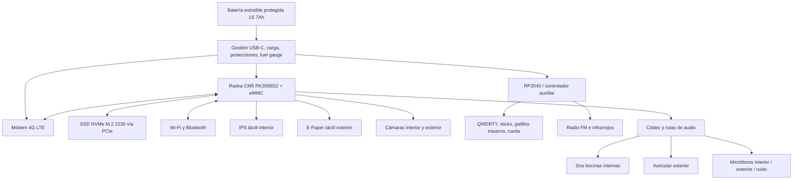

# Arquitectura inicial X-P1 (conceptual)

**Esto es un diagrama de bloques, NO un esquema conectado ni una asignación de GPIO.**

## Distribución candidata

- **Base inferior:** PCB portadora diseñada en KiCad; CM5, control auxiliar, módem, alimentación, teclado, sticks, batería y NVMe. Gatillos LT/LB/RB/RT en la **cara trasera de la base**, con uso principal abierto.
- **Tapa superior:** IPS + touch, bocinas estéreo laterales, cámara interior; al otro lado E-Paper + touch, cámara exterior, auricular y micrófono para llamadas cerrado.
- **Bisagra:** paso reparable de FPC, señales y alimentación; verificar ciclos, radio de flexión y antenas.

## Revisión esencial

Confirmar todos los carriles de PCIe/USB/CSI/DSI, potencia de pico del módem, regulación para CM5, consumo en reposo, impedancia RF y descarga térmica antes de ordenar prototipos. No conectar una celda Li-Po sin protección ni un cargador improvisado.